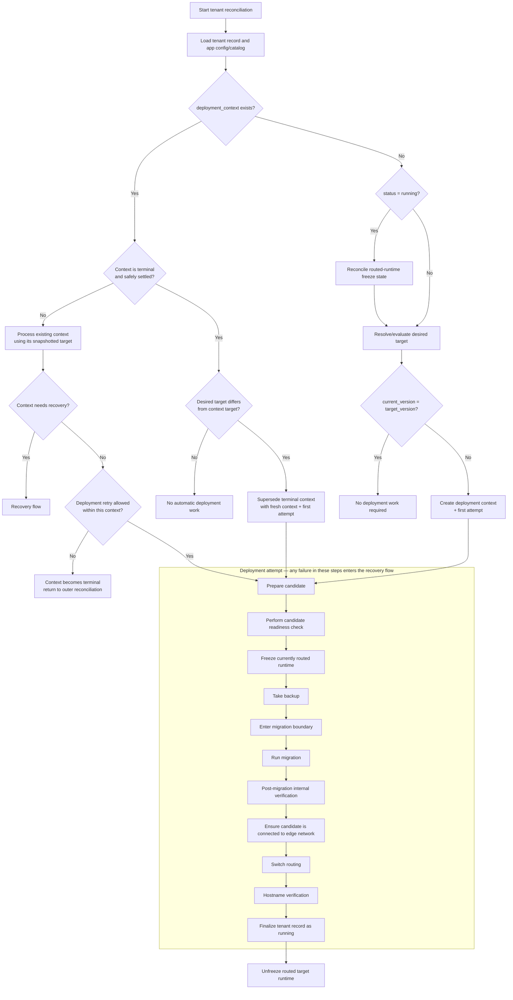
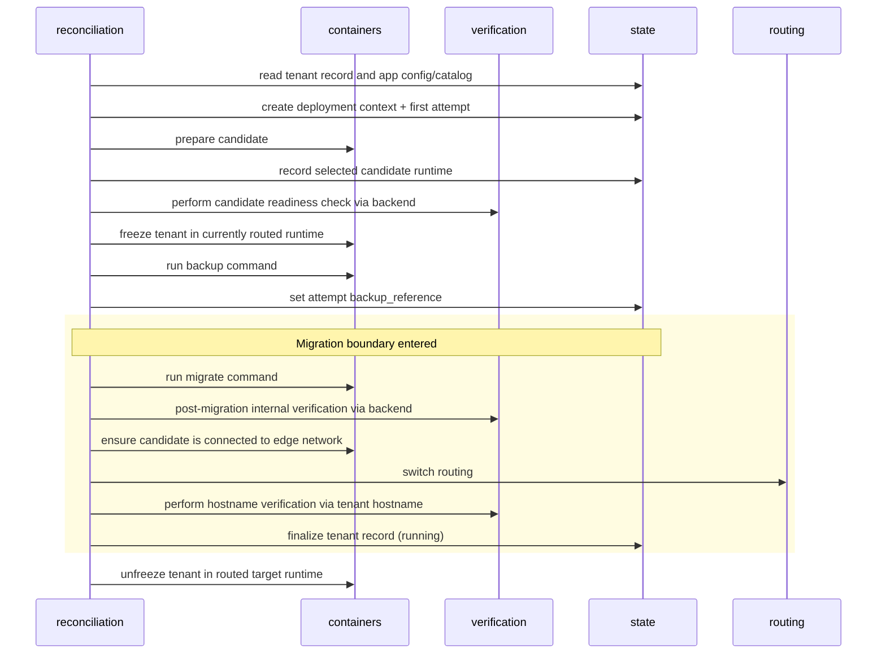
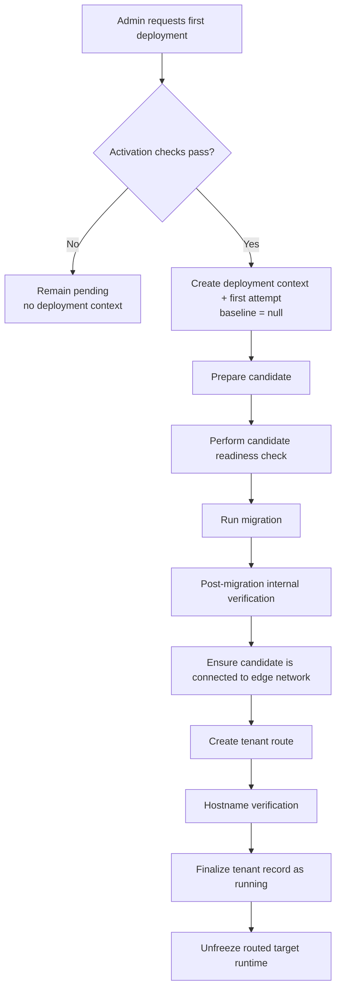
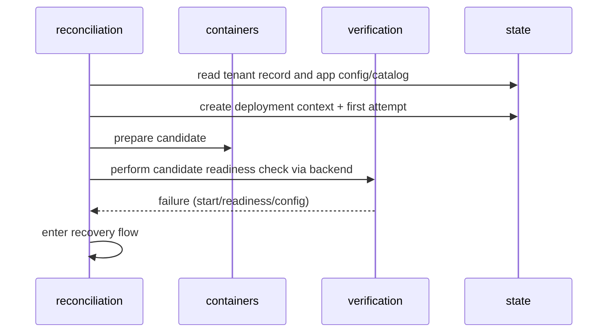
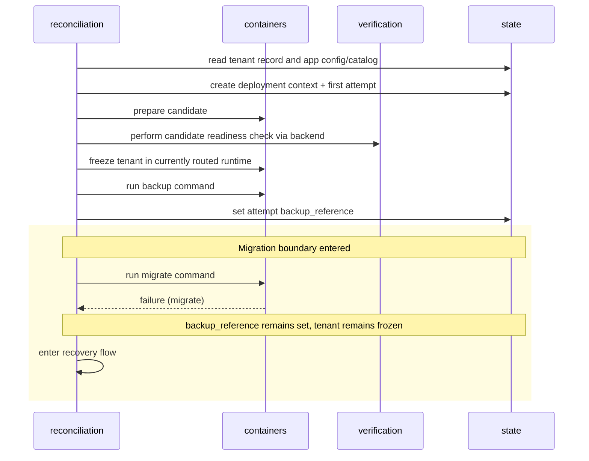
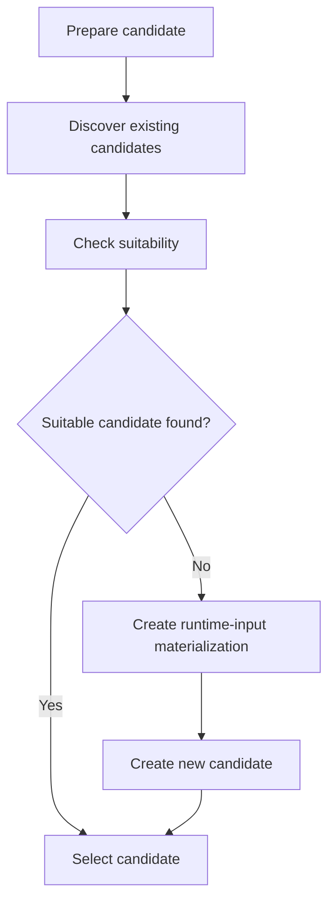

# Deployment Flow

## Overview

The deployment flow is the central tenant runtime scenario. It continues or recovers existing deployment work when present, or starts new deployment work when an eligible tenant needs to move toward its target version.

The deployer does not persist a step cursor. Each run loads the persisted tenant record and app configuration/catalog, inspects observed runtime reality, and chooses the next safe action.

For readability, `backup_reference` below means the active `deployment_context.attempt.backup_reference`; deployment retry metadata belongs to `deployment_context`.

## Top-level flow



The flowchart shows the meaningful top-level decisions and the successful deployment sequence. It is intentionally coarse-grained and should not be read as a complete module interaction sequence. Individual step-failure branches are intentionally collapsed: any failure in the deployment-attempt box enters recovery. The final unfreeze happens after finalization.

`pending` tenants do not start deployment work through ordinary reconciliation. Their first deployment begins through explicit admin action, as described in [First deployment](#first-deployment).

For a `running` tenant with no deployment context, routed-runtime freeze reconciliation completes before desired-target evaluation. This restores the expected `running` state before a new deployment attempt can begin, so unfinished availability repair from the previous attempt cannot be hidden by newer work. If the freeze query or required unfreeze fails, reconciliation is requeued without starting new deployment work.

Existing deployment work is settled before new target work is considered.

Only the operation that creates or starts the current attempt continues its forward deployment sequence. If a later reconciliation encounters that attempt persisted as `deploying`, the attempt is treated as interrupted and enters recovery rather than resuming the forward sequence.

Before creating a new deployment context, the deployer applies the canonical [new-context prerequisites](../../appendix/04_state_transition_spec.md#new-deployment-context).

## Deployment sequence

The sequence below shows the expected ordering when a tenant already has a routed runtime. First deployment differs at the freeze, backup, and migration stage and is shown separately below.

This sequence is especially important for the migration boundary:

- the candidate readiness check runs before the migration boundary is entered
- the deployment enters the migration boundary only after backup succeeds and `backup_reference` is set
- full internal verification happens after migration, while routing still points to the previous runtime
- hostname verification happens only after route switch
- the tenant record is finalized before the routed target runtime is unfrozen



Key boundary: the migration boundary is entered when `backup_reference` is set after backup succeeds and before migration is invoked.

Validation boundary:

- The candidate readiness check is pre-migration only.
- Post-migration internal verification runs after migration, when the target app and tenant database are expected to be compatible.
- Hostname verification runs after routing, through the real tenant hostname.

Notes:

- This diagram describes the success path only.
- Failure handling is summarized by phase and failure class below; detailed recovery behavior is defined in the recovery flow and canonical recovery references.
- `backup_reference` must be set before invoking the migration command; recovery uses it to determine whether the deployment entered the migration boundary.
- `status = deploying` and the deployment context/attempt are persisted before candidate preparation or other deployment side effects.
- The attempt records its rollback baseline before those side effects begin.
- Candidate preparation creates the selected runtime input materialization before a newly created candidate container is started.
- `finalize tenant record (running)` includes final state normalization, for example:
    - set `status = running`
    - set `current_version = deployment_context.target_version`
    - set `current_image = deployment_context.target_image`
    - clear `deployment_context`
- The tenant record is finalized before unfreeze so recovery cannot restore an old backup over writes accepted after unfreeze.
- This sequence is an architecture-level summary. Implementation-level command contracts and verification request/response details are defined in specs.
- Canonical state-transition requirements are defined in the appendix.

## First deployment

A first deployment is started explicitly by an admin for a `pending` tenant. Before changing the tenant state, the deployer performs [activation validation](../../appendix/04_state_transition_spec.md#activation-validation) and checks the canonical [new-context prerequisites](../../appendix/04_state_transition_spec.md#new-deployment-context). If either check fails, the tenant remains `pending`, with no deployment context and no deployment side effects.

When these checks succeed, the deployer creates the deployment context and first attempt with `baseline = null` and persists them before side effects begin. There is no previous routed runtime to freeze or back up, so the first-deployment path does not enter the migration boundary. Migration runs as `migrate --initial` from the persisted target image.



`current_version` and `current_image` remain `null` until successful finalization. Until then, a failed or interrupted first deployment enters the dedicated [first-deployment recovery](recovery_flow.md#first-deployment-recovery) branch.

## Failure sequence

Until finalization has succeeded, errors leave the deployment flow and enter the [recovery flow](recovery_flow.md). After finalization, an unfreeze failure is handled by normal `running`-state reconciliation instead.

The examples below illustrate two common cases: failure before entering the migration boundary, and failure after it has been entered. The distinction is important because it affects how recovery handles the failed attempt.

### Pre-migration failure

This example shows a failure before the migration boundary has been entered. The failure occurs during the candidate readiness check, before migration has been allowed to run. The deployment then immediately branches into the recovery flow.




### Failure within migration boundary

This example shows a failure after the migration boundary has been entered. The example uses the call to the app container's `migrate` command as the failing operation, but later failures within the migration boundary follow the same recovery path. Note that `backup_reference` remains set, allowing recovery to recognize that migration may have altered tenant state. The tenant also remains frozen, to prevent state mutation during recovery.



## Phase breakdown

### 1. Reconciliation entry

The deployer loads the persisted tenant record and app configuration/catalog and inspects:

- current and target version
- persisted status and deployment retry metadata
- routing target
- candidate/live containers
- backup reference and recovery metadata
- application-reported tenant freeze state where relevant

The outcome is one of:

- no deployment work required
- deployment path
- recovery path

### 2. Prepare candidate

The deployer prepares a candidate for the target version. Candidate preparation can reuse an existing suitable container or create a new candidate.

Candidate preparation has two local stages:

1. **Discovery** finds existing containers with matching deployment metadata.
1. **Suitability** checks whether a discovered container represents the desired runtime state.

Once a candidate has been selected, the deployer records its runtime instance ID in `deployment_context.attempt.candidate` before the readiness check or later deployment work uses it. This reference protects the selected runtime and its materialization from garbage collection while the attempt still depends on them. If the attempt switches to another candidate, the new selection replaces the previous reference only after the replacement candidate has been selected.

The decision flow below shows when the deployer reuses an existing candidate and when it creates a new one:



Detailed candidate discovery and suitability rules are defined in [Appendix - Candidate Selection and Suitability](../../appendix/13_candidate_selection_and_suitability.md).

Candidate preparation is still pre-migration. Failure here is a pre-migration failure:

- container could not be created or started
- required container setup failed
- no suitable existing container can be reused and a new candidate cannot be created

### 3. Candidate readiness check

The deployer performs the candidate readiness check before entering the migration boundary.

This check proves the candidate app process is reachable through the deployer-facing internal path and validates only things that are safe before tenant state migration. It is a runtime-level check: the deployer calls the candidate directly without tenant context, and the returned deploy token confirms that the application received the expected runtime input.

If a reused candidate fails the readiness check, the deployer creates a new candidate in the same deployment attempt and performs the readiness check again. This does not consume a deployment retry. If the new candidate also fails the readiness check, the attempt follows the normal pre-migration failure path.

Detailed reuse behavior is defined in [Candidate Selection and Suitability](../../appendix/13_candidate_selection_and_suitability.md#candidate-readiness-check).

### 4. Tenant freeze

The candidate runtime already treats the tenant as frozen. The deployer freezes the tenant in the currently routed runtime before backup.

`containers` invokes the runtime control command; `reconciliation` identifies the currently routed runtime. The application owns how the freeze guards its mutation sources.

### 5. Backup

After the currently routed runtime is frozen, the deployer takes a backup.

A backup failure before `backup_reference` is set is a pre-migration failure. Recovery does not restore from backup because migration was not invoked.

The deployer records `backup_reference` only after the backup command succeeds and the completed artifact is available at its canonical path. The reference is also logged so it remains available for inspection even if recovery or finalization later clears it from deployment state. The standardized event is defined in the [Logging Contract](../../appendix/10_logging_contract.md).

### 6. Migration boundary

The deployment enters the migration boundary by setting `backup_reference` after backup succeeds and before migration is invoked.

The boundary ends when successful finalization or safe recovery clears `backup_reference`. On the success path, the routed-runtime unfreeze happens after the boundary has ended.

Failures within the migration boundary enter recovery before deployment retry. Recovery is responsible for determining and applying the safety actions required to bring the tenant to a safe, classified outcome. This is performed as part of the recovery procedure.

Work within the migration boundary includes:

- running migration
- post-migration internal verification
- ensuring the candidate is connected to the edge-facing network
- route switch
- hostname verification
- finalization

### 7. Migration

The deployer invokes the app image `migrate` command. The application is responsible for performing any required schema or data migrations internally.

A migration failure or timeout enters recovery flow.

### 8. Post-migration internal verification

After migration succeeds, the deployer performs post-migration internal verification before routing is switched.

This is the full app/environment/tenant verification point. It may validate domain-specific assumptions that require the post-migration tenant state.

Failure enters recovery flow.

### 9. Candidate edge connectivity

After post-migration internal verification succeeds and before routing is switched, the deployer ensures the candidate is connected to the edge-facing network. An explicit connection action is only needed when it is not already connected; for example, a shared target may already be on the edge network because it serves other tenants.

This step prepares the candidate for real hostname traffic without changing the active route yet. Failure here occurs within the migration boundary and enters recovery flow.

Any restart follows the cross-cutting [verification-after-restart](../08_cross_cutting_concepts/readiness_and_verification.md#verification-after-restart) rule. If the candidate is expected to remain frozen, the [freeze-state restart verification invariant](../08_cross_cutting_concepts/tenant_freeze.md#restart-verification-invariant) also applies.

Concrete Docker network mechanics are specified in [Docker Run Flow](../../specs/1_docker_run_flow.md).

### 10. Cutover and hostname verification

The deployer switches routing to the candidate, then performs hostname verification through the real tenant hostname.

This proves both:

- routing points to the intended container
- tenant resolution works through the real request path

Failure enters recovery. Recovery determines whether route state needs to be restored before deployment retry.

### 11. Finalization

Only after post-migration internal verification, candidate edge connectivity is confirmed, route switch, and hostname verification succeed does the deployer finalize the tenant record.

The finalized tenant record is persisted before unfreeze. This ordering prevents recovery from restoring an old backup over writes accepted after unfreeze.

Finalization includes:

- set `current_version = deployment_context.target_version`
- set `current_image = deployment_context.target_image`
- set `status = running`
- clear `deployment_context`

### 12. Unfreeze

After finalization, the deployer unfreezes the routed target runtime.

If the deployer crashes after finalization or the final unfreeze fails, the tenant remains `running`. The runtime being temporarily frozen is now an operational/runtime-state problem, not a deployment-state problem. Periodic running-state reconciliation restores write availability by retrying the idempotent unfreeze.

Finalization separates deployment recovery from running-state repair:

```text
                         FINALIZATION
                              |
         recovery side        |        running side
                              |
migration / verify / route -->|--> unfreeze
          failure             |      failure
             |                |         |
          recovery            |   running reconciliation
```

Garbage collection of old containers, unsuitable containers, and materialized files is handled by the Garbage Collection Cycle, not by the deployment critical path.

## Key invariants

- The candidate readiness check runs before migration; post-migration verification does not run before migration.
- The migration boundary is entered by setting `backup_reference` after backup succeeds and before migration is invoked.
- Post-migration internal verification is required for every deployment mode.
- Candidate edge connectivity is confirmed after post-migration internal verification and before route switch.
- Route switch happens before hostname verification.
- The tenant record is finalized before the routed target runtime is unfrozen.

## Canonical references

- State transition table: [Appendix - State Transition Spec](../../appendix/04_state_transition_spec.md)
- Verification endpoint contracts: [Candidate Readiness and Deployment Verification](../../specs/2_verification.md)
- Migration command mechanics: [Backup + Migration Flow](../../specs/3_backup_and_migration.md)
- Docker candidate networking mechanics: [Docker Run Flow](../../specs/1_docker_run_flow.md)
- Route update mechanics: [Routing Update](../../specs/4_route_update.md)
